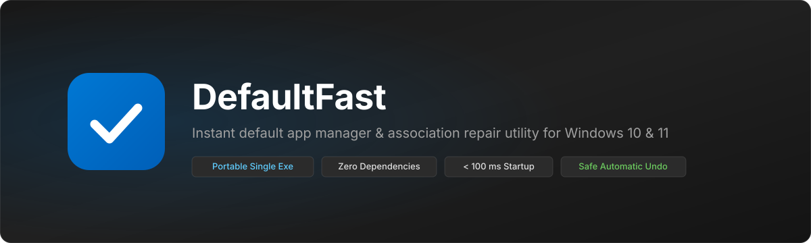
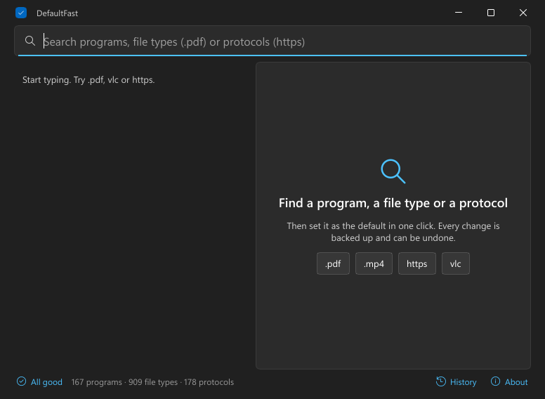
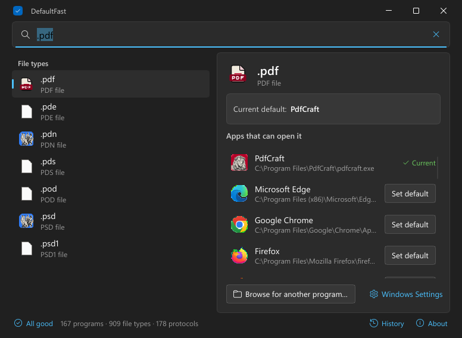
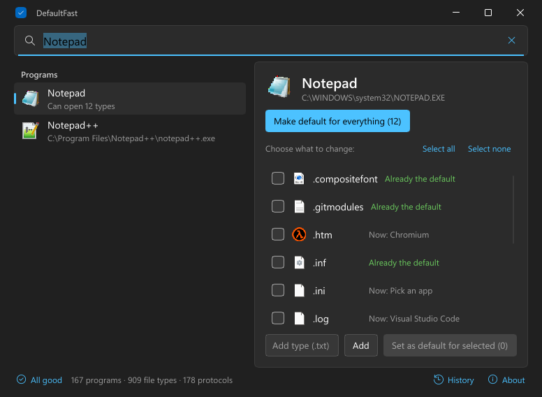
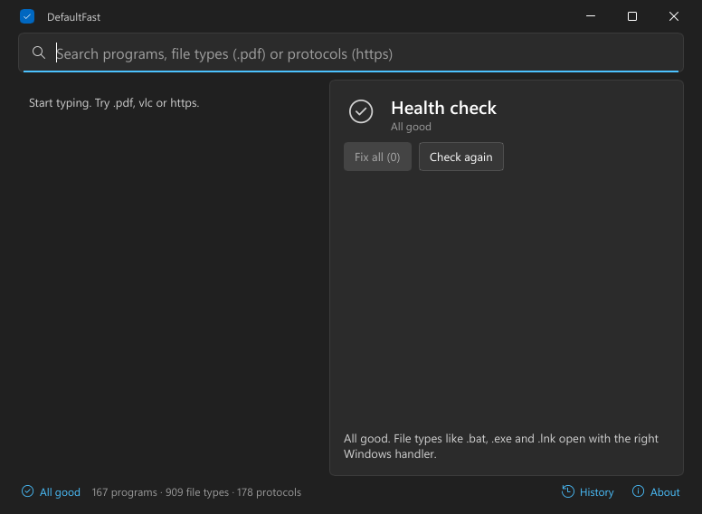
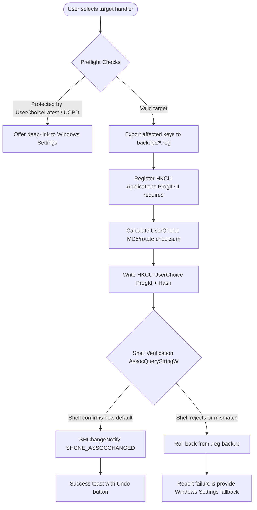

<p align="center">
  
</p>

<h1 align="center">DefaultFast</h1>

<p align="center">
  <strong>Fast, portable Windows default app manager and file association repair utility.</strong>
</p>

<p align="center">
  <a href="https://github.com/projectGloria/DefaultFast/releases"></a>
  
  
  <a href="LICENSE"></a>
</p>

<p align="center">
  
</p>

<p align="center">
  <a href="#about">About</a> •
  <a href="#features">Features</a> •
  <a href="#screenshots">Screenshots</a> •
  <a href="#how-it-works">How It Works</a> •
  <a href="#installation">Installation</a> •
  <a href="#usage">Usage</a> •
  <a href="#repair-and-safety">Repair &amp; Safety</a> •
  <a href="#building-from-source">Building from Source</a> •
  <a href="#diagnostics-and-budgets">Diagnostics &amp; Budgets</a> •
  <a href="#license">License</a>
</p>

---

## About

**DefaultFast** is a lightweight, portable Windows utility to instantly configure and repair default file types and protocol handlers. Windows Settings requires navigating multi-layered pages to change associations; DefaultFast lets you search an extension (`.pdf`), a protocol (`https`), or an application name (`VLC`), select your choice, and apply it in one keystroke.

It also automatically diagnoses and fixes broken file associations — including the recurring Windows bug where double-clicking `.bat` or `.cmd` scripts prompts *"Select an app to open this file"*.

Every change is executed through a verified transaction: keys are backed up to standard `.reg` files before writing, Shell registration is queried for confirmation, and changes roll back automatically if the system refuses them. DefaultFast runs as a standard user process with zero installers, zero runtime dependencies, and no network access.

## Features

- **Instant unified search**: Search across 900+ file extensions, 170+ protocols, and all installed desktop and packaged apps in under 3 ms.
- **Batch application defaults**: View every file type supported by a program (e.g. Media Player or Notepad) and associate them all or a selected subset with a single click.
- **Automatic association repair**: One-click health check detects empty handlers, missing ProgIDs, and shadowed extensions (such as broken `.bat`, `.cmd`, `.lnk`, `.exe`, or `.ps1` associations).
- **Safe transaction & rollback**: Computes legitimate UserChoice hashes; every write is verified through Windows Shell API (`AssocQueryStringW`) before marking successful, with instant rollback on denial.
- **Automatic `.reg` backups**: Exports registry states to `%LOCALAPPDATA%\DefaultFast\backups\*.reg` prior to modification, enabling one-click in-app Undo or standalone manual restoration.
- **Native Fluent UI & Snap integration**: Built with Slint and native Win32 window chrome supporting Windows 11 Snap Layouts, system dark/light themes, and keyboard navigation (`Ctrl+K`, `/`, `Enter`, `Esc`).
- **Minimal footprint**: Interactive window renders in under 95 ms with an idle memory footprint of approximately 21 MB.

## Screenshots

<p align="center">
  
  <br /><em>Instant search view: quick suggestions for extensions, protocols, and programs with background health scanning.</em>
</p>

<p align="center">
  
  <br /><em>Extension detail view: inspect the active handler, see registered programs, and reassign defaults in one click.</em>
</p>

<p align="center">
  
  <br /><em>Program detail view: bulk-assign all supported file types or selectively toggle specific formats.</em>
</p>

<p align="center">
  
  <br /><em>Health check pane: detect broken associations and restore missing or shadowed registry handlers.</em>
</p>

## How It Works

Windows restricts default app registration by storing user choices under `HKCU\Software\Microsoft\Windows\CurrentVersion\Explorer\FileExts\<ext>\UserChoice` protected by an undocumented hash. An invalid hash triggers an association reset or silent rejection.

DefaultFast implements a safe association transaction pipeline:



1. **Preflight**: Checks whether the target uses Windows 11's protected `UserChoiceLatest` or the UCPD driver (e.g. `http`, `https`, `.pdf` on recent OS builds). If blocked, it directs you cleanly to the appropriate Windows Settings page without half-applied changes.
2. **Registry Backup**: Before altering keys, DefaultFast generates a `.reg` file in `%LOCALAPPDATA%\DefaultFast\backups\`.
3. **Hash Calculation**: Generates the UserChoice hash matching the algorithm verified against Windows-generated keys on your machine.
4. **Shell Verification**: Asserts that Explorer (`AssocQueryStringW`) acknowledges the new association. If verification fails, the backup is restored immediately.
5. **Explorer Notification**: Issues `SHChangeNotify(SHCNE_ASSOCCHANGED)` so icons and file handlers update instantly without restarting Explorer.

## Installation

### Requirements
- **OS**: Windows 10 (version 1809 or higher, build 17763+) or Windows 11 (`x86_64`).
- **Permissions**: Runs entirely under standard user privileges. Administrator rights (UAC) are only requested when repairing machine-level `HKLM` keys for core file types.
- **Dependencies**: None. The single executable is self-contained.

### Download
Download the latest executable `DefaultFast.exe` from [GitHub Releases](https://github.com/projectGloria/DefaultFast/releases).

Place `DefaultFast.exe` in any folder or your `PATH`. No installation or setup process is needed.

## Usage

### Keyboard Shortcuts & Navigation

| Action | Shortcut / Input |
| --- | --- |
| **Focus Search** | `Ctrl+K` or `/` |
| **Navigate Results** | `↑` / `↓` arrow keys |
| **Open Detail Pane** | `Enter` on a selected result |
| **Toggle Checkbox** | `Space` in the supported types list |
| **Apply Default** | `Ctrl+Enter` or click **Set default** / **Set as default for selected** |
| **Make Default for All** | Click **Make default for everything** |
| **Dismiss / Back** | `Esc` (detail pane → search bar → clear query → home) |
| **Undo Last Change** | Click **Undo** on toast notification or navigate to **History** |

### Command-Line Arguments

You can integrate DefaultFast into scripts, run diagnostics, or create shortcuts for specific workflows:

```powershell
# Open directly with a search pre-filled:
.\DefaultFast.exe .pdf
.\DefaultFast.exe https
.\DefaultFast.exe Notepad

# Open directly into the Association Health Check:
.\DefaultFast.exe --repair

# Run headless diagnostics and generate diagnostics.txt:
.\DefaultFast.exe --diagnose

# Execute a self-contained registry write/verify/rollback test:
.\DefaultFast.exe --self-test

# Run cold-start and memory probe (used by measurement scripts):
.\DefaultFast.exe --startup-probe
```

### Unregistered Portable Apps

For standalone editors or portable utilities that do not create standard registry entries, DefaultFast provides an **Add type** field in their detail view. Entering `.txt` or another extension automatically creates `HKCU\Software\Classes\Applications\<exe>\shell\open\command` and links `SupportedTypes`, making the portable binary a first-class choice in Windows.

## Repair and Safety

### What the Health Check Detects
DefaultFast monitors critical system file associations against a known-good configuration table (`.bat`, `.cmd`, `.exe`, `.lnk`, `.msi`, `.ps1`, `.reg`, `.txt`, `.url`, `.vbs`, `.js`, `.zip`):
- Empty or shadowed default ProgIDs (e.g. an accidental empty `HKCU\Software\Classes\.bat` key breaking batch files).
- Missing handler binaries or uninstalled ProgIDs assigned in UserChoice.
- Corrupted or invalid UserChoice hash signatures.

### Elevation Policy
DefaultFast never runs elevated by default. When an association requires repairing `HKLM\SOFTWARE\Classes` (such as a damaged system `.cmd` entry):
1. A prompt displays the specific keys needing repair.
2. Upon confirmation, DefaultFast launches an elevated one-shot worker via `runas`:
   ```powershell
   DefaultFast.exe --elevated-fix .bat .cmd
   ```
3. The elevated worker validates each extension against the internal known-good table and rejects any writes outside `HKLM\SOFTWARE\Classes\.<ext>`.

### Data and Backup Directory
All state is stored in `%LOCALAPPDATA%\DefaultFast`:
- `backups\*.reg` — Automated backups saved prior to every registry edit (up to 50 kept).
- `log.txt` — Append-only audit log recording every registry modification.
- `window.txt` — Saved window size, position, and maximize state.

## Building from Source

### Prerequisites
- **Rust**: Version 1.88+ (`stable-x86_64-pc-windows-msvc`).
- **Visual Studio Build Tools**: Desktop development with C++ workload (MSVC linker and the Windows SDK with `rc.exe`).

### Build Steps

```powershell
# Clone the repository
git clone https://github.com/projectGloria/DefaultFast.git
cd DefaultFast

# Run test suite (31 unit tests covering hash, registry, and repairs)
cargo test

# Build optimized release binary
cargo build --release
```

The compiled standalone executable is generated at:
```
target\release\DefaultFast.exe
```

## Diagnostics and Budgets

DefaultFast is designed to satisfy strict performance and memory budgets:

| Metric | Target | Measured (Win 11 Build 26100) | Status |
| --- | --- | --- | --- |
| **Startup to First Frame** | < 150 ms | **92–95 ms** | Passed |
| **Idle RAM (Working Set)** | < 30 MB | **21.7 MB** (≈11 MB private) | Passed |
| **Search & Re-render Latency** | < 16 ms | **1.7–3.2 ms** (Search core ≈0.45 ms) | Passed |
| **Binary Size** | < 6 MB | **8.28 MB** (Slint 1.18 + software renderer) | Accepted trade-off |

Run the benchmark script locally across multiple iterations:
```powershell
.\scripts\measure.ps1 -Runs 5
```

See [docs/TESTPLAN.md](docs/TESTPLAN.md) for the manual quality assurance and verification test plan.

## License

This project is licensed under the [MIT License](LICENSE).

### Acknowledgments
- UserChoice hash reverse-engineering based on research by [SetUserFTA](https://kolbi.cz/blog/2017/10/25/setuserfta-userchoice-hash-defeated-set-file-type-associations-per-user/) and [PS-SFTA](https://github.com/DanysysTeam/PS-SFTA).
- Graphical user interface powered by [Slint](https://slint.dev/).
